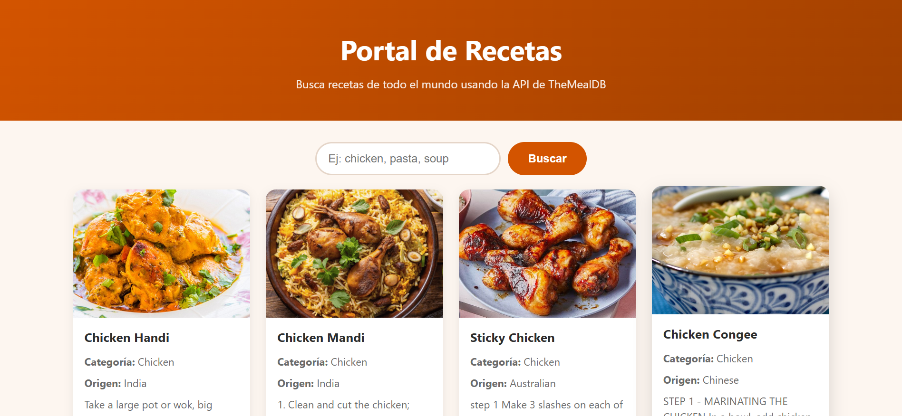

# 🍲 Portal de Recetas API



## Descripción
Aplicación web desarrollada durante el Técnico en Programación de Software (SENA).
Permite buscar recetas de cocina de distintos países consumiendo la API pública **TheMealDB**
a través de una **API propia construida en PHP**, que actúa como intermediaria entre el
navegador y el servicio externo.

## Objetivo
Demostrar el flujo completo de una aplicación web que consume datos externos:
interfaz HTML/CSS, interacción con JavaScript, una API propia en PHP que consulta
una API REST externa con cURL, y la gestión del proyecto con Git y GitHub
(commits, ramas, Issues y Pull Requests).

## Tecnologías
- HTML5
- CSS3 (Grid, variables CSS, diseño responsive)
- JavaScript (DOM, `fetch()`, `async/await`)
- PHP (cURL, JSON, códigos HTTP)
- API REST externa: [TheMealDB](https://www.themealdb.com/api.php)
- Git y GitHub

## Funcionalidades
- Buscar recetas por nombre (en inglés: *chicken, pasta, soup, beef...*).
- Mostrar resultados en tarjetas con imagen, categoría, país de origen e instrucciones.
- Filtrar los resultados por categoría y ver el contador de resultados.
- Validar la búsqueda antes de enviarla (campo vacío o muy corto).
- Mostrar mensajes controlados cuando la API falla o no hay resultados.
- Diseño adaptable a celulares, tablets y computador.

## Estructura
```
portal-recetas-api/
├── index.html          → interfaz principal
├── css/estilos.css     → estilos y diseño responsive
├── js/app.js           → lógica del frontend (DOM, fetch, filtro, errores)
├── api/recetas.php     → API propia en PHP que consulta TheMealDB con cURL
├── img/sin-imagen.svg  → imagen por defecto cuando una receta no tiene foto
├── evidencias/         → capturas del proyecto
├── docs/flujo.md       → explicación del flujo de datos
├── .gitignore          → archivos que no se suben al repositorio
└── README.md
```

## API utilizada
**TheMealDB** – API pública y gratuita de recetas (no requiere clave para la versión de prueba).

| Endpoint externo | Uso en el proyecto |
|---|---|
| `https://www.themealdb.com/api/json/v1/1/search.php?s={nombre}` | Buscar recetas por nombre |
| `https://www.themealdb.com/api/json/v1/1/list.php?c=list` | Listar categorías |

## Endpoints de la API propia
| Método | Endpoint | Descripción |
|---|---|---|
| GET | `api/recetas.php?accion=buscar&nombre=pasta` | Devuelve las recetas que coinciden con el nombre |
| GET | `api/recetas.php?accion=categorias` | Devuelve la lista de categorías |

### Ejemplo de respuesta JSON (búsqueda)
```json
{
  "total": 1,
  "recetas": [
    {
      "id": "52795",
      "nombre": "Chicken Handi",
      "categoria": "Chicken",
      "origen": "Indian",
      "imagen": "https://www.themealdb.com/images/media/meals/wyxwsp1486979827.jpg",
      "instrucciones": "Take a large pot or wok...",
      "video": "https://www.youtube.com/watch?v=IO0issT0Rmc"
    }
  ]
}
```

### Ejemplo de respuesta de error
```json
{ "error": "Debes enviar el nombre de una receta." }
```
Códigos usados: `200` (éxito), `400` (petición inválida), `502` (falla de la API externa).

## Flujo de la aplicación
```
Usuario
  ↓
HTML / formulario de búsqueda
  ↓
JavaScript (valida y hace fetch)
  ↓
api/recetas.php (PHP + cURL)
  ↓
API TheMealDB
  ↓
JSON
  ↓
PHP simplifica los datos → JSON propio
  ↓
JavaScript procesa, filtra y crea las tarjetas
  ↓
Interfaz
```
Más detalle en [docs/flujo.md](docs/flujo.md).

## Ejecución
1. Clonar el repositorio:
   `git clone https://github.com/miguelitooo165/portal-recetas-api.git`
2. Abrirlo en Visual Studio Code.
3. Ubicar la carpeta dentro de `C:\xampp\htdocs\` (o el equivalente en Laragon).
4. Iniciar **Apache** desde el panel de XAMPP (la extensión cURL de PHP debe estar activa).
5. Abrir en el navegador: `http://localhost/portal-recetas-api/`

> ⚠️ GitHub solo almacena el código: PHP **no** se ejecuta en GitHub, por eso se necesita un servidor local.

## Limitaciones conocidas
- La búsqueda funciona con nombres en inglés, porque TheMealDB tiene sus datos en inglés.
- La versión gratuita de TheMealDB solo permite buscar por un criterio a la vez.
- El filtro por categoría se aplica sobre los resultados de la búsqueda actual, no sobre toda la base de datos.
- Requiere conexión a internet y un servidor local con PHP.

## Aprendizajes
- Consumir una API REST externa desde PHP con cURL y transformar su JSON.
- Construir una API propia sencilla con respuestas JSON y códigos HTTP.
- Usar `fetch()` y `async/await` para comunicar el frontend con el backend.
- Manejar errores tanto en el servidor como en el navegador.
- Trabajar con Git usando ramas, commits significativos, Issues y Pull Requests.

## Autor
Miguel Munar
Ficha 3538620
Técnico en Programación de Software - SENA
